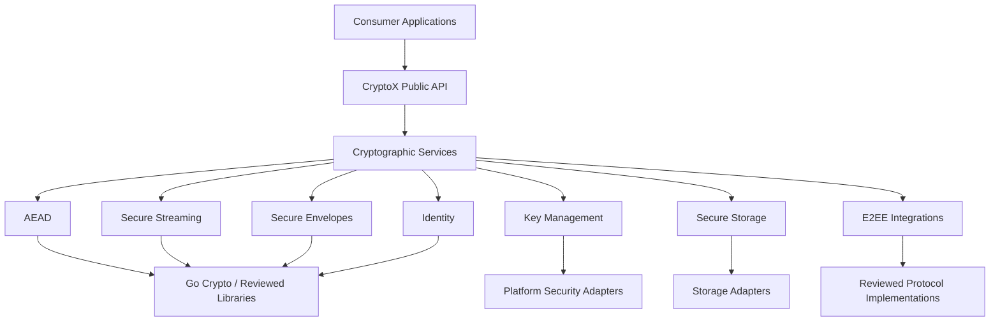

# CryptoX — Software Architecture

> **Status:** Proposed Architecture
> **Project:** CryptoX
> **Repository:** https://github.com/Hangell/cryptox
> **Primary Language:** Go
> **Architecture:** Modular, Hexagonal, Security-First
> **License:** MIT
> **Classification:** Open Source Cryptographic SDK

---

## 1. Overview

CryptoX is a modular, security-first cryptographic SDK written primarily in Go.

Its purpose is to provide reliable, reusable, auditable, and interoperable cryptographic capabilities for applications requiring confidentiality, authenticity, integrity, and secure management of cryptographic material.

CryptoX is designed as a **general-purpose cryptographic foundation**, not as a library dedicated exclusively to messaging.

Target use cases include:

- End-to-end encrypted messaging.
- Secure file storage and transfer.
- Encrypted backups.
- Offline-first applications.
- Secure communication between services.
- Cryptographic device identities.
- Encrypted local databases.
- IoT communication.
- Privacy-focused applications.
- Enterprise security systems.
- Future post-quantum cryptographic integrations.

CryptoX must remain independent of transport protocols, database engines, cloud providers, and application frameworks.

### Implemented baseline and target boundaries

The current checkout implements `keys.GenerateKey`, legacy v1 file operations in
`stream`, and a deprecated `utils` facade. The library uses the Go standard library.
Public APIs accept file paths; the internal reader-based parser is not a public
secure-streaming contract. Tests and a CI configuration exist.

The legacy format does not authenticate complete stream termination or all header
metadata. Empty files do not authenticate the key, and 64-bit nonce prefixes can
collide across files under a reused key. See [SECURITY.md](SECURITY.md) for current
limitations. The requirements below describe the target architecture, not a claim
that the baseline already meets them.

Progress and outstanding acceptance gates are maintained in
[ROADMAP.md](ROADMAP.md#current-progress). Initial observations in
[the diagnostic snapshot](docs/architecture/diagnosis.md) are historical evidence,
not the current status tracker.

### 1.1 Architectural objectives

The architecture must prioritize:

1. Security and correctness.
2. Resistance to API misuse.
3. Modularity and maintainability.
4. Testability and auditability.
5. Interoperability.
6. Cryptographic agility without unsafe downgrade.
7. Portability.
8. Predictable performance.
9. Minimal dependencies.
10. Long-term evolution.

Security takes precedence over convenience, performance, and backward compatibility.

---

## 2. Architectural Principles

### 2.1 Security by Design

All modules must adopt secure defaults.

Fundamental rules:

- Fail closed when cryptographic verification fails.
- Never expose plaintext after an authentication failure.
- Never reuse an AEAD key-and-nonce combination.
- Never silently downgrade a cryptographic suite.
- Never implement custom encryption algorithms.
- Never log private keys, session secrets, plaintext, or sensitive derived values.
- Never treat encryption without authentication as sufficient.
- Never rely on obscurity for security.
- Validate all external inputs and serialized structures.
- Use cryptographically secure randomness.
- Explicitly define trust boundaries.
- Reject malformed, incomplete, or unsupported cryptographic structures.

### 2.2 Separation of Concerns

CryptoX is responsible for cryptographic operations and related security abstractions.

It is not responsible for application business logic or network infrastructure.

CryptoX must not implement:

- HTTP servers.
- WebSocket gateways.
- Message brokers.
- User registration flows.
- Push notification services.
- Application authorization policies.
- Database orchestration.
- Cloud infrastructure management.

These belong to consuming applications.

### 2.3 Dependency Inversion

High-level cryptographic orchestration should depend on explicit capabilities rather than concrete infrastructure adapters.

Interfaces must be created only when a genuine abstraction boundary exists.

Avoid unnecessary interfaces for simple cryptographic functions.

### 2.4 Composition over Inheritance

Prefer small, composable components with clearly defined responsibilities.

Do not create inheritance-like abstractions or excessive interface hierarchies.

### 2.5 Explicit Security Guarantees

Every cryptographic module must document:

- What it protects.
- What it does not protect.
- Required assumptions.
- Supported algorithms.
- Failure behavior.
- Key lifecycle requirements.
- Relevant limitations.

A component must never claim stronger security guarantees than its implementation provides.

---

## 3. Architectural Model

CryptoX follows a modular architecture inspired by Hexagonal Architecture and Clean Architecture.

These patterns must improve clarity and security rather than introduce unnecessary complexity.

### 3.1 Logical architecture



The diagram represents logical dependencies, not mandatory runtime layers.

Consumers may import focused packages directly when appropriate.

### 3.2 Dependency rules

- Core cryptographic components must not import application-specific packages.
- Core packages must not depend on HTTP, databases, queues, or cloud SDKs.
- External adapters depend on CryptoX contracts.
- Protocol adapters depend on reviewed protocol implementations.
- Lower-level cryptographic code must remain reusable independently.
- Avoid circular dependencies.
- Avoid global mutable cryptographic configuration.
- Prefer explicit initialization and dependency injection.

---

## 4. Package Structure

The following structure is the architectural target.

Packages must be introduced incrementally and only when their functionality is implemented and tested.

```text
cryptox/
├── aead/
│   ├── aesgcm/
│   └── chacha20poly1305/
│
├── keys/
│   ├── derivation/
│   ├── exchange/
│   ├── signatures/
│   └── lifecycle/
│
├── stream/
│   ├── framing/
│   └── integrity/
│
├── envelope/
│   ├── format/
│   └── encoding/
│
├── identity/
│   ├── devices/
│   ├── verification/
│   └── transparency/
│
├── securestorage/
│   └── adapters/
│
├── e2ee/
│   ├── sessions/
│   ├── devices/
│   ├── groups/
│   └── adapters/
│
├── pki/
│   └── validation/
│
├── compat/
│
├── internal/
│   ├── validation/
│   ├── encoding/
│   └── errors/
│
├── examples/
├── testdata/
│   ├── vectors/
│   └── malformed/
│
├── docs/
│   └── adr/
│
├── AGENTS.md
├── ARCHITECTURE.md
├── ROADMAP.md
├── SECURITY.md
├── CONTRIBUTING.md
├── LICENSE
├── README.md
└── go.mod
```

Avoid creating empty directories or placeholder abstractions.

The actual package layout may evolve when supported by technical justification and documented architectural decisions.

### 4.1 Current implementation status

As of Phase 3 start (2026-10-19), the repository contains these Go packages:

- `keys` — key generation and HKDF-SHA-256 purpose-separated derivation, plus
  the `keys/lifecycle` sub-package implementing the one-way key lifecycle state
  machine from ADR 0005 and the `keys/signatures` sub-package providing
  Ed25519/Ed25519ctx signing with explicit domain-separation contexts (RFC 8032).
  Remaining target subpackages (`derivation`, `exchange`) will be introduced
  incrementally in later phases.
- `stream` — the v2 authenticated streaming format (`CXS2`), its file adapters,
  and the deprecated legacy v1 reader (`SYM1`) retained only for explicit
  migration (ADR 0004).
- `aead` — AES-256-GCM authenticated encryption with associated data, wrapping
  the Go standard library with a misuse-resistant API.
- `envelope` — Envelope v1 container (see
  [docs/spec/envelope-v1.md](docs/spec/envelope-v1.md)).
- `securestorage` — backend-independent storage contracts
  (`securestorage/interfaces`) for the Phase 3 secure-storage layer.
- `identity` — experimental identity track (Phase 4): `identity/credentials`
  provides versioned, purpose-bound, signed credentials with a canonical
  encoding, and `identity/verification` provides domain-separated public-key
  fingerprints for out-of-band comparison (ADR 0006).
- `utils` — a deprecated compatibility facade over `keys` and `stream`. It is
  not part of the target tree and will be removed before the stable API
  (see ADR 0004).

The remaining target directories do not exist yet. They must be introduced only
with a clear contract, implementation, and tests — never as empty placeholders.
This invariant is enforced by `structure_test.go`.

### 4.2 Component disposition

Every current component has an explicit disposition. The legacy v1 format is
never promoted to new security guarantees.

| Component | Disposition | Rationale and next step |
| --- | --- | --- |
| `keys` | Reuse | `GenerateKey` draws from `crypto/rand` with size validation. Refactor into the target `keys/` subpackages (`generation`, `derivation`, `lifecycle`) in Phase 1. |
| `aead` | Reuse | New Phase 1 package wrapping the Go standard library AES-256-GCM with a misuse-resistant API; no custom cipher construction. |
| `envelope` | Reuse | New Phase 2 package implementing Envelope v1 over AES-256-GCM; format specified independently in `docs/spec/envelope-v1.md`. |
| `securestorage` | Reuse | New Phase 3 package defining backend-independent storage contracts (`securestorage/interfaces`) implemented by filesystem, in-memory, and OS adapters. |
| `identity` | Reuse | New experimental Phase 4 package providing signed, purpose-bound credentials (`identity/credentials`) and out-of-band fingerprints (`identity/verification`); isolated from the stable core per ADR 0006. |
| `stream` (v1 format) | Replace | Lacks whole-file integrity and authenticated termination (CX-V1-001/003/004). Superseded by the v2 format selected in ADR 0002; v1 is never reinterpreted as v2. The reader parser may be adapted only as an isolated legacy reader with explicit no-migration documentation. |
| `utils` | Remove | Deprecated facade that delegates to `keys` and `stream`. Remove with documented impact after the Phase 1/2 replacements; do not extend its API. |

---

## 5. Cryptographic Architecture

### 5.1 Cryptographic primitives

CryptoX must rely on established, publicly reviewed primitives and implementations.

Initial candidates:

| Purpose | Algorithm or standard |
|---|---|
| Symmetric authenticated encryption | AES-256-GCM |
| Alternative AEAD | ChaCha20-Poly1305 |
| Key derivation | HKDF-SHA-256 |
| Classical key agreement | X25519 |
| Digital signatures | Ed25519 |
| Password-based key derivation | Argon2id |
| Cryptographic randomness | Go `crypto/rand` |
| Post-quantum key encapsulation | ML-KEM through reviewed implementations |
| Individual E2EE sessions | Established ratcheting protocols |
| Group E2EE | MLS, RFC 9420 |

These are candidate technologies, not instructions to combine them into a new protocol.

Every cryptographic composition requires explicit security justification.

### 5.2 Cryptographic agility

Algorithm agility must be controlled by versioned policies.

Requirements:

- Explicitly identify supported suites.
- Authenticate suite identifiers and negotiation transcripts.
- Reject unsupported suites.
- Prevent downgrade attacks.
- Avoid algorithm selection directly controlled by untrusted ciphertext.
- Version persistent formats.
- Document migration requirements.

Cryptographic agility must not become unrestricted algorithm configurability.

### 5.3 Cryptographic random number generation

Use cryptographically secure randomness.

Requirements:

- No predictable seeds.
- No mathematical pseudo-random generators for secrets.
- No fallback to insecure randomness.
- Propagate failures where the selected API can fail.
- Validate key and nonce sizes.
- Avoid exposing randomness providers as unrestricted production configuration.

Deterministic randomness may be injected in carefully isolated tests only.

---

## 6. AEAD Module

The AEAD module provides authenticated encryption.

### Responsibilities

- Symmetric encryption.
- Authentication and integrity verification.
- Nonce management.
- Associated authenticated data.
- Input validation.
- Secure error handling.

### Requirements

- Prefer APIs that generate and manage nonces automatically.
- Document maximum messages per key.
- Reject invalid key sizes.
- Never reuse a nonce with the same key.
- Authenticate relevant metadata.
- Never return unauthenticated plaintext.
- Prefer established AEAD implementations.
- Avoid generic encryption interfaces that permit unsafe combinations.

AEAD operations for standalone messages and encrypted streams must be treated as different use cases.

---

## 7. Secure Streaming Architecture

Secure streaming is a foundational capability of CryptoX.

It must support files and streams without requiring the complete plaintext to reside in memory.

### 7.1 Requirements

- Bounded memory consumption.
- Authenticated encryption.
- Secure framing.
- Explicit format versioning.
- Chunk ordering validation.
- Truncation detection.
- End-of-stream authentication.
- Header and metadata authentication.
- Counter exhaustion detection.
- Strict input size limits.
- Safe failure behavior.
- Secure temporary file handling.

### 7.2 Format design

The new streaming format must not inherit security properties from the previous format without verification.

The format should provide:

- Authenticated header.
- Version identifier.
- Cryptographic suite identifier.
- Nonce or key derivation context.
- Chunk sequence binding.
- Finalization authentication.
- Limits on maximum file size.
- Explicit handling of malformed structures.

The implementation must detect:

- Deleted chunks.
- Reordered chunks.
- Modified chunks.
- Truncated files.
- Missing finalization records.
- Invalid length fields.
- Counter overflow.

### 7.3 Security boundary

Chunk-level AEAD authentication is not sufficient to guarantee global stream integrity.

The complete stream must have authenticated ordering and termination semantics.

No streaming format should be considered production-ready without adversarial testing and independent security review.

### 7.4 File publication contract

File adapters publish output through a common contract:

- Output is written to a unique temporary file in the destination directory.
- On success the temporary file is synced, closed, and atomically renamed over
  the destination, replacing any existing file. Overwrite is part of the
  contract, not an opt-in.
- On any error the temporary file is removed and an existing destination is
  left untouched.
- The destination directory is not fsynced, so power-loss durability is not
  guaranteed. Rename atomicity and crash behavior vary by OS and filesystem.
- A process crash can leave temporary files. Callers using a trusted directory
  may remove stale `.cryptox-*` files; no automatic recovery is promised.
- The v2 file adapter must inherit this contract or a stronger one.

---

## 8. Key Management Architecture

Key management must be independent of individual cryptographic algorithms.

### 8.1 Responsibilities

- Cryptographically secure key generation.
- Key derivation.
- Key identification.
- Purpose separation.
- Lifecycle management.
- Rotation orchestration.
- Storage integration.
- Revocation-related state.
- Controlled key import/export.

### 8.2 Key separation

Keys must not be reused across unrelated cryptographic purposes.

Use distinct keys or correctly defined derived subkeys for:

- Message encryption.
- File encryption.
- Authentication.
- Storage encryption.
- Identity.
- Session state.
- Backups.

Key derivation must include domain separation appropriate to the protocol.

### 8.3 Secret handling

Requirements:

- Avoid unnecessary copies.
- Minimize secret lifetime.
- Prevent logging.
- Avoid accidental serialization.
- Do not expose secrets through error messages.
- Prevent unsafe concurrent mutations.
- Document Go garbage collector limitations.

CryptoX must not guarantee complete or immediate memory erasure in Go.

### 8.4 Hardware-backed storage

The architecture must support optional integration with:

- Android Keystore.
- Apple Keychain.
- Secure Enclave where supported.
- Hardware Security Modules.
- Operating-system credential stores.

Hardware-backed storage must remain an optional integration.

The core must not depend on a specific platform.

---

## 9. Secure Envelope Architecture

The envelope module defines versioned structures for encrypted objects.

### Responsibilities

- Serialization.
- Deserialization.
- Version management.
- Metadata validation.
- Algorithm identification.
- Authenticated metadata handling.

### Security requirements

- Reject malformed data.
- Reject unsupported versions.
- Enforce strict size limits.
- Avoid ambiguous encodings.
- Bind security-relevant fields cryptographically.
- Prevent downgrade behavior.
- Avoid unnecessary metadata exposure.

Envelope specifications must be documented independently from implementation details.

A generic encrypted envelope must not be confused with a complete secure messaging protocol.

---

## 10. Identity Architecture

CryptoX may provide reusable cryptographic identity capabilities.

### Responsibilities

- Device identity keys.
- Public-key verification.
- Digital signatures.
- Credential representation.
- Key identification.
- Identity change detection.
- Integration with transparent key directories.

### Security boundaries

CryptoX does not determine whether a real-world person is trustworthy.

CryptoX provides cryptographic identity mechanisms that consuming applications can use to implement trust policies.

The library must distinguish:

- Cryptographic identity.
- Device identity.
- Application accounts.
- Human identity.
- Authentication.
- Authorization.

These concepts must not be treated as interchangeable.

---

## 11. E2EE Architecture

E2EE is an optional higher-level capability.

CryptoX must not attempt to recreate mature messaging protocols without formal justification and independent review.

### 11.1 Responsibilities

- Protocol adapter contracts.
- Session integration.
- Device identity integration.
- Persistent cryptographic state interfaces.
- Protocol interoperability testing.
- Secure serialization boundaries.
- Error classification.

### 11.2 Protocol candidates

Potential integrations include:

- Signal-family protocols for individual sessions.
- MLS for group communication.
- Reviewed post-quantum mechanisms when appropriate.

The exact protocol implementation must be selected through an Architecture Decision Record.

### 11.3 Mandatory properties

Depending on the selected protocol, the integration should support:

- Authenticated session establishment.
- Message confidentiality.
- Message integrity.
- Forward secrecy.
- Post-compromise security.
- Replay protection.
- Device authentication.
- Secure state persistence.
- Multi-device identity handling.
- Explicit session failure behavior.

These properties must be documented according to the actual protocol guarantees and threat assumptions.

### 11.4 Explicit exclusions

CryptoX E2EE must not implement:

- Message transport infrastructure.
- Push notifications.
- Presence management.
- User discovery.
- Application account systems.
- Social graph storage.
- Server-side message routing.

---

## 12. Secure Storage Architecture

The secure storage module provides interfaces and components for encrypted persistence.

### Responsibilities

- Encrypted state representation.
- Storage adapter contracts.
- Key separation.
- Versioned persistence.
- Authenticated metadata.
- Recovery and migration support.

### Security requirements

- Reject corrupted records.
- Authenticate security-relevant state.
- Consider rollback and replay threats.
- Avoid leaking sensitive metadata unnecessarily.
- Define atomic write expectations.
- Protect state against partial writes.
- Document storage-layer assumptions.

Authenticated encryption alone does not prevent rollback attacks against previously valid stored states.

Applications requiring rollback resistance must use an appropriate trusted state or monotonic mechanism.

---

## 13. Design Patterns

Design Patterns must be applied selectively.

| Pattern | Intended application |
|---|---|
| Strategy | Controlled cryptographic implementation selection |
| Adapter | Platform and protocol integrations |
| Factory | Validated construction of security-sensitive objects |
| Facade | Simplified public APIs |
| State Machine | Cryptographic sessions and device lifecycle |
| Dependency Injection | Explicit capabilities and testability |
| Repository | Persistent state abstractions |
| Builder | Complex validated configurations |
| Functional Options | Safe optional configuration |

### Restrictions

- Do not use patterns merely for abstraction.
- Avoid unnecessary dependency injection containers.
- Avoid singleton key stores.
- Avoid mutable global cryptographic registries.
- Avoid exposing unsafe implementation details.
- Prefer small and explicit APIs.

Security and clarity take precedence over pattern purity.

---

## 14. Threat Model

Threat modeling is mandatory.

It is initially maintained within this document and may later be extracted into a dedicated document as complexity grows.

### 14.1 Protected assets

Critical assets include:

- Private identity keys.
- Session secrets.
- Plaintext data.
- File encryption keys.
- Cryptographic persistent state.
- Device credentials.
- Backup recovery material.
- Authentication-related secrets.

### 14.2 Threat actors

Consider:

- External attackers.
- Malicious network intermediaries.
- Compromised application servers.
- Malicious storage providers.
- Attackers controlling encrypted inputs.
- Compromised client devices.
- Malicious or impersonated participants.
- Supply-chain attackers.
- Attackers with access to historical ciphertext.

### 14.3 Threat scenarios

| Threat | Required architectural response |
|---|---|
| Ciphertext modification | Authenticated encryption |
| Message replay | Protocol-specific replay protection |
| Nonce reuse | Safe nonce lifecycle and limits |
| File truncation | Authenticated stream termination |
| Chunk reordering | Authenticated sequence binding |
| Key substitution | Authenticated identity verification |
| Key compromise | Explicit rotation and recovery policies |
| Storage rollback | Trusted state or documented limitations |
| Malformed input | Validation and fuzzing |
| Dependency compromise | Supply-chain controls |
| Device compromise | Hardware protection where possible and explicit limitations |
| Protocol downgrade | Authenticated negotiation and version policies |

### 14.4 Trust boundaries

The architecture must distinguish:

1. Application-controlled plaintext.
2. CryptoX public APIs.
3. Cryptographic secret state.
4. External storage.
5. Untrusted serialized input.
6. Network-delivered encrypted data.
7. Platform-specific secure storage.
8. External protocol implementations.

All data crossing a trust boundary must be validated according to its threat model.

### 14.5 Limitations

CryptoX must not claim to protect against every compromise.

Examples of limitations:

- A fully compromised application process may expose plaintext.
- A compromised operating system may undermine secret protection.
- E2EE does not automatically conceal communication metadata.
- Encryption does not prevent denial-of-service attacks.
- Cryptography does not guarantee secure deletion from physical media.
- Hardware-backed keys do not make all application data inaccessible to malware.

---

### 14.6 Legacy v1 risk register

Assessment scope: the current `stream` implementation, not a security certification.
Owner for all entries: project maintainer. P0/P1 are engineering priorities, not
CVSS scores. Likelihood is expressed through the required conditions rather than
unsupported numerical estimates. The source and named tests are the evidence.

| ID | Priority / status | Threat, conditions, and impact | Evidence or reproduction | Mitigation and residual work |
| --- | --- | --- | --- | --- |
| CX-V1-001 | P0 / Open | An attacker able to edit ciphertext can remove complete trailing records; a shortened plaintext is accepted. | `TestV1TrailingTruncation` in `stream/parser_test.go` accepts only the first record of a two-record fixture. | Do not rely on v1 for whole-file integrity. Replacement requires authenticated termination and total-stream binding. |
| CX-V1-002 | P0 / Open | Multiple files under the same key use random 64-bit prefixes; a collision reuses chunk nonces and undermines GCM security. Exposure increases with key reuse. | `EncryptLargeFiles` fills only `baseNonce[:8]` from randomness. No probabilistic collision test is claimed. | Fresh key per v1 file is operational guidance, not an enforced guarantee. Replacement must specify key derivation, domain separation, and quantitative usage limits through review. |
| CX-V1-003 | P1 / Open | An empty/header-only file contains no tag and accepts a valid-length key without proving that it is the correct key. | `TestV1TruncationLimitation` accepts a header-only file; `decryptV1` reaches EOF without calling `Open`. | Require authenticated finalization even for zero-length plaintext. Do not use empty-file success to verify keys. |
| CX-V1-004 | P1 / Open | Header parsing is not full metadata authentication; future code could incorrectly trust unbound metadata. | `Seal` and `Open` use nil AAD. `TestLegacyHeaderValidation` checks structure, not cryptographic binding. | Authenticate all security-relevant version, suite, and framing metadata in the replacement. Strict parsing remains necessary but insufficient. |
| CX-V1-005 | P1 / Controlled within tested scope | Hostile length fields, fragmented reads, invalid tags, and short writes may cause parsing errors or incomplete output. | `TestDecryptMalformedRecords`, `TestDecryptFragmentedReader`, `TestDecryptIOErrors`, and `FuzzDecryptV1`. | Bound record allocation and propagate I/O errors. Fuzzing is finite and does not establish resistance to every denial-of-service scenario. |
| CX-V1-006 | P1 / Partially controlled | Failure after decrypting a prefix can expose temporary plaintext; a crash can leave that file behind. An untrusted directory or compromised process invalidates filesystem assumptions. | `TestFiles`, `TestLegacyAuthenticationFailure`, and `TestPublishFailureCleanup` exercise permissions, failed authentication, and failed publication. | Unique temporary files and Unix `0600`; trusted directories and Windows ACLs are required. Cleanup failures, process crashes, and disk-full behavior need additional review/testing. |
| CX-V1-007 | P1 / Controlled counter boundary | Counter wraparound would repeat a nonce within one file. | `checkCounter` and `TestCounterBoundary` reject values above `math.MaxUint32`. | This is a boundary-unit test, not a full maximum-size file test. Cryptographic per-key data limits remain a separate replacement-format requirement. |
| CX-V1-008 | P2 / Open platform limitation | A crash around rename can lose the published directory update; rename atomicity differs across platforms/filesystems. | File adapters sync and close the temporary file but do not sync the directory. No crash-durability test is claimed. | Define supported publication/durability semantics and test interruption behavior; do not promise durable transactions today. |
| CX-V1-009 | P2 / Explicitly out of current scope | A valid older ciphertext can be replayed or restored, and a compromised process/OS can expose secrets. | No trusted version state, replay protocol, or guaranteed memory erasure exists. | Document application trust boundaries; AEAD alone does not provide rollback protection, E2EE, or OS isolation. |

Tests that reproduce accepted truncation are limitation tests, not evidence that
the behavior is safe. Controlled entries do not close the open format-level risks.
A test passing for a known limitation must not be presented as a security fix.

### 14.7 Replacement-format evaluation gate

Before implementing or freezing a replacement, record an ADR evaluating maintained,
reviewed streaming constructions and implementations. Do not combine candidate
primitives into a proprietary protocol without the required specialist review.
The evaluation must address:

1. Authenticated headers, suite/version identifiers, ordering, and termination,
   including empty streams and removal of any complete suffix (CX-V1-001/003/004).
2. Nonce/key lifecycle, domain separation, randomness failures, and quantitative
   limits per key, file, record, and byte count (CX-V1-002/007).
3. Unambiguous bounded framing, malformed input, unknown versions, and explicit
   rejection without downgrade or legacy reinterpretation (CX-V1-004/005).
4. Plaintext-release semantics for file and reader/writer APIs, short I/O, cleanup,
   destination replacement, crash behavior, and platform assumptions (CX-V1-006/008).
5. Independent vectors, cross-implementation tests, mutation/property tests,
   fuzzing, and a review plan; a round trip alone is insufficient evidence.
6. Maintenance, licensing, dependency costs, supported platforms, and documented
   alternatives, including the option to adopt an existing format directly.
7. Explicit migration or no-migration policy for v1, with no claim to recover
   integrity evidence that legacy ciphertext never contained.
8. Scope exclusions for replay, rollback, metadata privacy, and compromised
   endpoints unless a separately reviewed layer supplies them (CX-V1-009).

The next decision is construction selection and specialist review, not approval
of a new wire format. Phase 0 architecture approval and Phase 1 entry criteria
remain open in [ROADMAP.md](ROADMAP.md#current-progress).

---

## 15. Security Testing Architecture

Security testing must be integrated into development.

### Required categories

- Unit tests.
- Integration tests.
- Known-answer tests.
- Official test vectors.
- Negative tests.
- Fuzzing.
- Property-based tests.
- Concurrency and race tests.
- Serialization and parsing tests.
- Cross-platform tests.
- Compatibility tests.
- Performance benchmarks.
- Static analysis.
- Dependency vulnerability analysis.

### Adversarial tests

At minimum:

- Invalid keys.
- Invalid nonces.
- Truncated ciphertext.
- Modified authentication tags.
- Invalid headers.
- Unsupported versions.
- Oversized payloads.
- Integer overflow.
- Reordered chunks.
- Replayed messages.
- Corrupted persistent state.
- Unexpected end-of-stream.
- Concurrent access to sensitive state.

Tests must verify that failures do not expose unauthenticated plaintext.

### Quality requirements

High code coverage is desirable but does not prove cryptographic security.

Security-critical components require test vectors and independent review in addition to automated test coverage.

---

## 16. Performance Architecture

CryptoX must provide predictable resource consumption.

Performance targets should be established using repeatable benchmarks rather than arbitrary claims.

Measure:

- Encryption throughput.
- Decryption throughput.
- Memory allocations.
- Peak memory consumption.
- Garbage collector overhead.
- Latency.
- Streaming performance.
- Behavior under concurrency.
- ARM64 and AMD64 performance.
- Large-file behavior.

Performance optimization must not weaken authentication, nonce handling, key separation, or input validation.

Prefer measured optimizations over premature complexity.

---

## 17. Cross-Platform Architecture

Go remains the primary implementation language.

Supported desktop/server targets:

- Linux.
- Windows.
- macOS.

Potential mobile integrations:

- Android.
- iOS.

Mobile integration may use bindings or platform-specific adapters.

### Security considerations

- Validate key handling across FFI boundaries.
- Avoid exposing private material unnecessarily.
- Document ownership and lifetime of secret buffers.
- Test crash and interruption behavior.
- Validate platform key-store integration.
- Verify cryptographic interoperability.

Do not require a single binary implementation across every platform when doing so compromises security or maintainability.

---

## 18. Observability

CryptoX must support diagnostics without exposing sensitive information.

Allowed diagnostics may include:

- Operation categories.
- Non-sensitive error codes.
- Execution durations.
- Algorithm identifiers when appropriate.
- Format versions.
- Resource usage.

Prohibited diagnostics include:

- Private keys.
- Session secrets.
- Plaintext.
- Passwords.
- Recovery secrets.
- Sensitive key derivation inputs.
- Entire encrypted envelopes by default.

Do not introduce telemetry or remote reporting as a mandatory dependency.

---

## 19. Dependency Management

External dependencies must be justified.

Evaluation criteria:

- Security history.
- Maintenance activity.
- Public audit availability.
- License compatibility.
- Supported platforms.
- API stability.
- Interoperability.
- Supply-chain integrity.

Prefer Go standard-library implementations when they satisfy the security and portability requirements.

Do not choose dependencies exclusively based on popularity or benchmark results.

Record security-relevant dependency decisions in ADRs.

---

## 20. Versioning and Compatibility

CryptoX currently has no known production consumers.

Therefore, the initial architectural modernization does not require preserving legacy public APIs or encrypted formats.

The project may:

- Remove obsolete packages.
- Replace unsafe implementations.
- Rename public APIs.
- Change serialization formats.
- Reorganize modules.
- Remove unnecessary dependencies.

However:

- Changes must be documented.
- Legacy vulnerabilities must be understood.
- Old cryptographic formats must not silently migrate into new security guarantees.
- New formats must receive explicit version identifiers.
- Future releases must follow a defined compatibility policy.

Once a stable release is published, compatibility must be managed deliberately.

The operational versioning and release rules (SemVer for the module vs. the
`SYM1`/`CXS2`/`CXE1` format identifiers, minimum Go, support window, protected
tags, and changelog) are published in [docs/versioning.md](../docs/versioning.md).

---

## 21. Architecture Governance

Architecture decisions affecting security must be documented.

Use Architecture Decision Records for:

- Cryptographic algorithm selection.
- Protocol integration.
- Streaming format design.
- Key management strategies.
- Serialization formats.
- Mobile integration.
- Persistent-state security.
- Public API changes.
- Dependency changes affecting trust boundaries.

Each ADR should include:

- Context.
- Decision.
- Alternatives.
- Security implications.
- Compatibility implications.
- Consequences.

Security-sensitive changes require explicit review.

---

## 22. Architectural Acceptance Criteria

A module is architecturally acceptable when:

1. Its responsibilities are clear.
2. Its trust boundaries are documented.
3. Its security properties are explicit.
4. It uses reviewed cryptographic components.
5. It rejects malformed inputs safely.
6. It avoids unsafe defaults.
7. Its public API is understandable.
8. It has relevant adversarial tests.
9. Its dependencies are justified.
10. Its limitations are documented.
11. It does not create unnecessary coupling.
12. It supports the project's long-term portability goals.

Passing unit tests alone is insufficient for security-critical components.

---

## 23. Implementation Direction

Implementation follows the phases defined in `ROADMAP.md`.

The architectural order of priority is:

1. Establish the security model.
2. Stabilize cryptographic foundations.
3. Implement authenticated streaming.
4. Implement key management abstractions.
5. Implement secure envelope formats.
6. Implement secure storage integration.
7. Implement cryptographic identity capabilities.
8. Integrate reviewed E2EE protocols.
9. Validate cross-platform operation.
10. Obtain independent security review.

Do not implement higher-level protocols before the underlying architectural and security assumptions are documented.

---

## 24. Final Architectural Principles

CryptoX must be:

**Secure by default.**
Security must not depend on developers knowing undocumented pitfalls.

**Modular.**
Applications should use only the capabilities they require.

**Auditable.**
Critical behavior must be explicit and independently verifiable.

**Portable.**
Core cryptographic functionality must not depend on cloud vendors or application frameworks.

**Interoperable.**
Documented formats and established protocols should enable independent implementations.

**Extensible.**
New applications and integrations must not require rewriting existing foundations.

**Conservative in cryptography.**
Innovation should focus on safe APIs, architecture, integration and developer experience rather than unreviewed cryptographic inventions.

**Honest about security guarantees.**
No module may claim protection beyond its actual assumptions and demonstrated properties.

---

## 25. Long-Term Vision

CryptoX aims to become a trusted open source cryptographic toolkit for the Go ecosystem.

Its value will come from combining:

- Strong engineering discipline.
- Secure cryptographic abstractions.
- Well-defined security boundaries.
- High-quality documentation.
- Cross-platform integrations.
- Predictable performance.
- Reusable components.
- Independent security review.

The project's mission is not merely to encrypt data.

**Its mission is to make secure cryptographic integration easier, more reliable, independently verifiable, and less dependent on proprietary infrastructure.**
